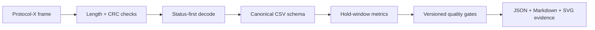

# Multichannel Thermal Validation Toolkit

[](https://github.com/Aleck-Tao/multichannel-thermal-validation-toolkit/actions/workflows/ci.yml)
[](https://www.python.org/)
[](LICENSE)

A reproducible research and engineering toolkit for testing the complete path from a binary sensor frame to a defensible multichannel thermal-validation decision.

The repository connects four concerns that are often evaluated separately: transport integrity, per-channel status semantics, time-series quality, and experiment-level acceptance gates. It is designed as a clean-room public demonstrator: all identifiers are codenames, Protocol-X is fictional, and every committed measurement is generated by the repository.


## Research question

How can a multichannel measurement pipeline avoid treating a plausible numeric value as trustworthy when its frame, channel status, timing, or cross-channel behavior is invalid?

The implementation makes the evidence chain explicit:



## What is implemented

- A typed binary-frame codec with strict length, version, message-type, and CRC checks.
- Status-first decoding: faulted values are represented as unusable instead of silently entering statistics.
- A deterministic, configurable ramp-and-hold simulator for arbitrary channel counts.
- Channel-level validity, mean error, peak error, drift, and residual-noise metrics.
- Experiment-level pairwise-spread checks and a versioned JSON policy.
- Deterministic JSON, Markdown, CSV, and SVG artifacts checked by CI.
- Nine unit tests covering corrupted frames, truncated packets, fault flags, deterministic generation, schema stability, confidentiality gates, and baseline/degraded decisions.

## Reproduce the evidence

```bash
python -m venv .venv
# Linux/macOS
source .venv/bin/activate
# Windows PowerShell
# .venv\Scripts\Activate.ps1

python -m pip install -e .
python -m unittest discover -s tests -v
python -m thermal_validation demo --root .
```

Expected decision summary:

```json
{
  "baseline": {"passed": true, "issues": 0},
  "degraded": {"passed": false, "issues": 8}
}
```

The degraded dataset intentionally injects invalid status flags, a channel offset, and a hold-period drift. A `FAIL` result is therefore evidence that the gates detect the controlled faults, not evidence of a product failure.

## Committed benchmark

| Synthetic dataset | Decision | Channels | p95 pairwise spread | Max spread | Issues |
|---|---:|---:|---:|---:|---:|
| `baseline.csv` | PASS | 10 | 0.3026 °C | 0.3071 °C | 0 |
| `degraded.csv` | FAIL | 10 | 1.1843 °C | 1.2180 °C | 8 |

See [the generated comparison](results/comparison.md), [baseline report](results/baseline_report.json), and [degraded report](results/degraded_report.json) for machine-readable evidence.

## Protocol-X safety properties

Protocol-X is an intentionally invented public protocol, not a redacted commercial register map. Its purpose is to demonstrate reusable engineering controls:

1. Reject a frame before decoding if its declared length or CRC is invalid.
2. Reject unsupported versions and message types explicitly.
3. Evaluate status flags before exposing the numeric temperature.
4. Preserve sequence, timestamp, and channel identity for downstream traceability.

Details and a byte-level specification are in [docs/protocol_x.md](docs/protocol_x.md).

## Evidence boundary

| Artifact | Provenance | Appropriate claim |
|---|---|---|
| Source code and tests | Public clean-room implementation | Software and validation design capability |
| `data/synthetic/*.csv` | Deterministically generated | Reproducibility and controlled fault detection |
| `results/*` | Generated from committed synthetic data | Behavior of the public pipeline under its stated policy |
| Commercial documents, screenshots, firmware maps, calibration constants | Not included | No public claim or reconstruction |

This repository does **not** publish client/company names, product identifiers, serial numbers, chip identities, proprietary register addresses, calibration coefficients, production screenshots, or real customer measurements. Read [docs/disclosure_boundary.md](docs/disclosure_boundary.md) before adapting the toolkit.

## Repository map

```text
thermal_validation/       frame codec, simulator, analysis, reporting, CLI
config/validation_policy.json
data/synthetic/           generated baseline and fault-injected runs
results/                  reproducible reports and vector plots
docs/                     architecture, method, protocol, disclosure boundary
tests/                    nine deterministic unit tests
```

## Limitations

- The simulator is designed for regression tests, not for thermal-plant identification.
- Protocol-X is not wire-compatible with a real device.
- The default thresholds are demonstrator policy values, not product tolerances or safety certification criteria.
- The current analysis assumes a shared reference profile and synchronized timestamps.
- No claim of field accuracy, certification, or deployment performance is made from synthetic data.

## Related work in this portfolio

- [Safety-constrained UAV mission interface](https://github.com/Aleck-Tao/safety-constrained-uav-mission-interface)
- [UAV multisensor diagnostics](https://github.com/Aleck-Tao/uav-multisensor-diagnostics)
- [UAV flight-video quality audit](https://github.com/Aleck-Tao/uav-flight-video-quality-audit)
- [Computer vision and autonomous systems portfolio](https://github.com/Aleck-Tao/computer-vision-autonomous-systems-portfolio)

## License and citation

Code is released under the [MIT License](LICENSE). Citation metadata is provided in [CITATION.cff](CITATION.cff).
