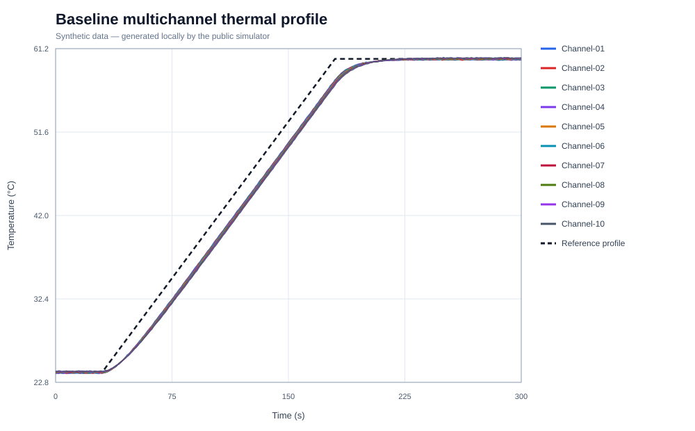

# Multichannel Thermal Validation Toolkit

[](https://github.com/Aleck-Tao/multichannel-thermal-validation-toolkit/actions/workflows/ci.yml)

A Python toolkit for separating channel bias, drift and missing measurements in a ramp-and-hold experiment. The public example uses ten simulated channels and a shared 24–60 °C reference profile. All committed measurements are generated by the repository.



## What the injected faults reveal

The reference reaches 60 °C at 180 seconds. Acceptance metrics use the 240–300 second window, allowing the simulated first-order responses to settle before measuring hold error.

| Dataset | p95 channel spread | Maximum spread | Decision |
|---|---:|---:|:---:|
| Baseline | 0.3026 °C | 0.3071 °C | PASS |
| Degraded | 1.1843 °C | 1.2180 °C | FAIL |

The degraded run introduces three different faults. Their signatures in [degraded_report.json](results/degraded_report.json) explain why a single noise or accuracy number is insufficient:

| Channel | Injected fault | Observed signature |
|---|---|---|
| 04 | +1.05 °C offset and periodic sensor-open status | Mean hold error +1.0112 °C; valid fraction 96.35%; drift −0.0049 °C/min |
| 08 | Additional drift from 195 s | Hold drift +0.4187 °C/min; mean error +0.5465 °C; residual noise 0.0259 °C RMS |
| 09 | Stale status at 235–245 s | Valid fraction 96.35%, while retained hold samples have only +0.0880 °C mean error |

Channel 04 is biased but nearly flat. Channel 08 can look quiet after a fitted trend is removed, even while its mean error and drift fail the policy. Channel 09 shows why excluding invalid samples is only half the job: the remaining numbers look plausible, so completeness also needs its own check. Valid fraction covers the whole run; error, drift and residual noise use valid samples in the hold window.

Cross-channel spread checks agreement at shared timestamps, while reference error checks agreement with the target. A common offset added to every channel would cancel out of the spread, so small spread alone cannot establish accuracy. Conversely, spread is computed only from valid channels; a missing channel does not contribute a value. The separate validity threshold makes that loss visible.

See the [comparison](results/comparison.md), [baseline report](results/baseline_report.json) and [validation policy](config/validation_policy.json) for the full decisions. The degraded case triggers eight checks as expected.

## Run the example

From a checkout, with Python 3.11 or newer:

```bash
python -m pip install -e .
python -m thermal_validation demo --root .
```

This regenerates both datasets, reports and plots. The expected decisions are baseline `passed: true` with zero issues and degraded `passed: false` with eight issues. CI repeats the demo and compares the generated files with the committed output. Run the tests with:

```bash
python -m unittest discover -s tests -v
```

To inspect a generated dataset under the same policy:

```bash
python -m thermal_validation validate data/synthetic/degraded.csv
```

A rejected validation returns exit code `2`. The public CSV reader requires `synthetic=true`.

## Frame integrity and channel status

The repository also includes a codec for **Protocol-X**, an intentionally fictional binary protocol. It checks frame length, version, message type and CRC before decoding a sample, then maps non-valid status flags to an unusable temperature. Sequence, timestamp and channel identity remain available for inspection.

CRC and status checks serve different purposes: a frame may arrive intact while its sensor reports an open circuit or stale value. The [codec](thermal_validation/protocol_x.py) and [frame tests](tests/test_protocol_x.py) exercise that distinction. The ramp-and-hold demo writes synthetic CSV directly; it does not route those measurements through a device or the binary codec. The byte layout is documented in [protocol_x.md](docs/protocol_x.md).

The simulator assumes synchronized channels and a shared reference. Its policy values are demonstration thresholds, not measured device tolerances. [experimental_method.md](docs/experimental_method.md) describes the response model and hold-window metrics; [disclosure_boundary.md](docs/disclosure_boundary.md) explains the public implementation's separation from commercial measurements and protocols.

Related: [multi-sensor diagnostics](https://github.com/Aleck-Tao/uav-multisensor-diagnostics) · [mission interface](https://github.com/Aleck-Tao/safety-constrained-uav-mission-interface) · [portfolio](https://github.com/Aleck-Tao/computer-vision-autonomous-systems-portfolio). Code: [MIT](LICENSE); citation: [CITATION.cff](CITATION.cff).
